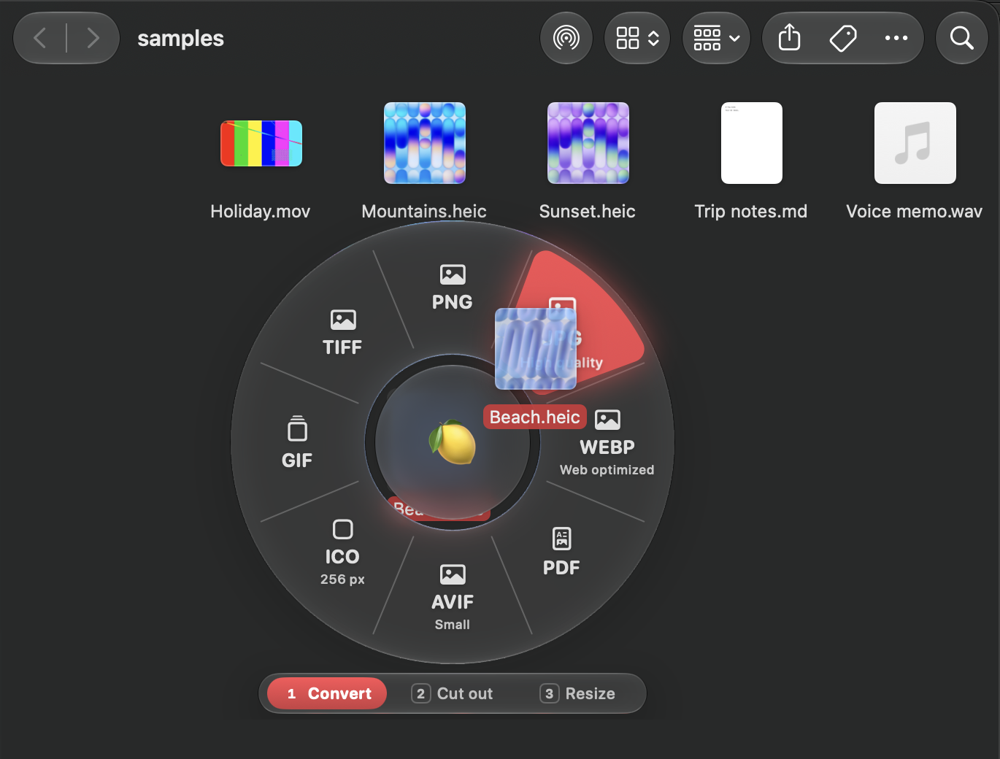
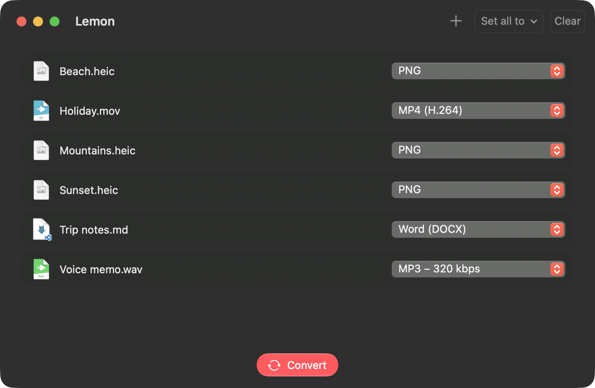

<h1 align="center">Lemon</h1>

A drag-and-drop file converter for **Windows** and **macOS**. Drop in pictures, audio, video or documents, pick a format for each file (or for all of them at once), and convert the whole batch in parallel. Or skip the window: while you drag files anywhere on your computer, shake the mouse and a wheel of formats pops up under the pointer. Drop on one and the converted copy appears next to the original.

**Download:** [Releases page](https://github.com/Kataruna/Lemon/releases) (Windows releases are tagged `windows-v…`, Mac releases `mac-v…`). On a Mac, also `brew install --cask kataruna/tap/lemon`. See the [install guide](INSTALL.md).

| Guide | What's in it |
|---|---|
| [INSTALL.md](INSTALL.md) | Installing, first steps, converters, updating and uninstalling, on Windows and Mac |
| [DETAIL.md](DETAIL.md) | How each part works: the wheel, the queue, every conversion, Optimize, Remove background, settings |
| [BUILD.md](BUILD.md) | Building, testing, packaging and releasing both apps, and where the code lives |

## Features

- **Conversion wheel.** While you drag files from anywhere (File Explorer, Finder, the desktop, a browser…), shake the mouse or press a key (Alt on Windows, Control on Mac, or your own) and a round menu of formats opens under the pointer. You can also select files in File Explorer (hold Alt) or Finder (hold Control). Drop on a format to convert right away; drop on the lemon in the middle to add the files to the queue. **Esc** closes the wheel without cancelling the drag.
- **Rings.** The wheel has rings for *Convert*, *Optimize*, *Cut out* (remove the background) and *Resize*, plus up to five rings of your own. Switch with **Tab**, the number keys, the scroll wheel, or by resting the files on a ring's name. A hub can show all the rings at once.
- **Commands.** Your own shell (or PowerShell) commands on a Commands ring for dragged files, folders and links: shake a project folder to open it in your terminal or editor, or a link from the browser to hand it to your own tool. See [DETAIL.md](DETAIL.md#commands).
- **Batch queue.** Drop files or whole folders on the window, give each file its own preset (or use *Set all to*), and convert them in parallel with live progress.
- **Optimize.** Makes images, videos and PDFs smaller in the same format, with the quality kept close to the original, in three strengths: *Lossless*, *Balanced* and *Smaller*.
- **Remove background.** Cuts the subject out of a picture onto a transparent PNG, with the BiRefNet AI model running on your own computer (and Apple Vision on the Mac).
- **Resize.** Shrinks pictures to 4K, Full HD, HD or SD in the same format. It also upscales 2× or 4× with the Real-ESRGAN AI model running on your own computer.
- **Presets.** Dozens built in (*WebP – Web optimized*, *MP3 – 320 kbps*, *MP4 – 720p small*, *Animated GIF*…), and your own with quality, size, bitrate, CRF, frame rate and metadata settings.
- **Make it yours.** Themes (including your system's accent color), glass, the emoji in the middle, which formats go on the wheel, and which ring each kind of file opens on, all with a live preview.
- **Welcome guide.** On first launch, Lemon offers to install the free converters it uses (with `winget` on Windows, Homebrew on Mac) and shows how the wheel works.
- **Update check.** Lemon tells you when a newer version of your platform's app is on the Releases page. Nothing installs by itself, and nothing else is sent. It can be turned off in *Settings › About*.
- **Safe output.** Originals are never overwritten. A taken name becomes `name (1).ext`, and half-written files are removed when a conversion fails or is cancelled.

## Windows and Mac

The two apps are written separately (C# / WinUI 3 and Swift / SwiftUI) and share no code, but they work the same way. The differences:

| | Windows | Mac |
|---|---|---|
| Runs on | Windows 10 (2004+) and 11, 64-bit | macOS 14 Sonoma or later, Apple silicon |
| Lives in | The notification area (by the clock) | The menu bar |
| Wheel key by default | Alt (pressed mid-drag, or held over files selected in File Explorer) | Control (held mid-drag, or over files selected in Finder) |
| Pictures | Built in (bundled ImageMagick) | ImageMagick from Homebrew |
| Simple documents | Markdown and text built in | DOCX, ODT, RTF, HTML and text built in (`textutil`) |
| Remove background | BiRefNet on the GPU (DirectML) or CPU | Apple Vision, or BiRefNet on the CPU |
| AI upscale | Real-ESRGAN on the GPU (DirectML) or CPU | Real-ESRGAN on the GPU and Neural Engine (Core ML) or CPU |
| Right-click *Convert with Lemon* | Yes | Not yet |
| Packages | Installer and portable `.exe` | `Lemon.app` in a zip |

## Inspiration

[Tangerine](https://apps.apple.com/app/tangerine-file-converter/id6813034065) on macOS, whose drag-and-drop conversion (and hold-Shift gesture) Lemon started from, and [Clop](https://lowtechguys.com/clop/), which Optimize follows (its aggressive mode became *Smaller*).

## How it was made

Lemon was developed with AI coding agents (Claude Code): the agents wrote the code, tests and docs. A human directed the work, designed the user experience, and tested the apps on real Windows and Mac machines.

## Thanks

Lemon is a friendly front end on top of a lot of excellent free software. Thank you to everyone who builds and maintains these projects.

**The converters** that do the real work:

| Project | What Lemon uses it for |
|---|---|
| [ImageMagick](https://imagemagick.org) | Pictures: every image format, Resize, and Optimize for JPEG, PNG, WebP and GIF (on Windows through [Magick.NET](https://github.com/dlemstra/Magick.NET), built in) |
| [FFmpeg](https://ffmpeg.org) | Audio and video, and Optimize for videos |
| [Pandoc](https://pandoc.org) | Documents and ebooks: DOCX, ODT, RTF, HTML, Markdown, EPUB |
| [LibreOffice](https://www.libreoffice.org) | Office files to PDF |
| [Ghostscript](https://www.ghostscript.com) | Optimize for PDFs |

**Remove background:**

| Project | What Lemon uses it for |
|---|---|
| [BiRefNet](https://github.com/ZhengPeng7/BiRefNet) | The AI model that cuts out the subject, in the ONNX versions published by [ONNX Community](https://huggingface.co/onnx-community) ([Lite](https://huggingface.co/onnx-community/BiRefNet_lite-ONNX), [full](https://huggingface.co/onnx-community/BiRefNet-ONNX)) |

**Upscale:**

| Project | What Lemon uses it for |
|---|---|
| [Real-ESRGAN](https://github.com/xinntao/Real-ESRGAN) | The AI models that enlarge pictures (`realesr-general-x4v3` and `RealESRGAN_x4plus`, BSD 3-Clause, © 2021 Xintao Wang), exported to ONNX by `windows/packaging/export-upscale-models.py` |
| [ONNX Runtime](https://onnxruntime.ai) | Runs the model: with DirectML on Windows, and through the [Swift package](https://github.com/microsoft/onnxruntime-swift-package-manager) on Mac |

**Libraries and tools in the apps:**

| Project | What Lemon uses it for |
|---|---|
| [Windows App SDK](https://github.com/microsoft/WindowsAppSDK) (WinUI 3) | The Windows app's interface |
| [.NET Community Toolkit](https://github.com/CommunityToolkit/dotnet) (MVVM) | View models in the Windows app |
| [Markdig](https://github.com/xoofx/markdig) | Markdown to HTML on Windows, without Pandoc |
| [xUnit](https://xunit.net) | The Windows tests |
| [Inno Setup](https://jrsoftware.org/isinfo.php) | The Windows installer |
| [winget](https://github.com/microsoft/winget-cli) and [Homebrew](https://brew.sh) | Installing the converters from the welcome guide |

## Issues

Report problems on the [issue tracker](https://github.com/Kataruna/Lemon/issues). On Windows, `%LOCALAPPDATA%\Lemon\errors.log` is useful to attach.
